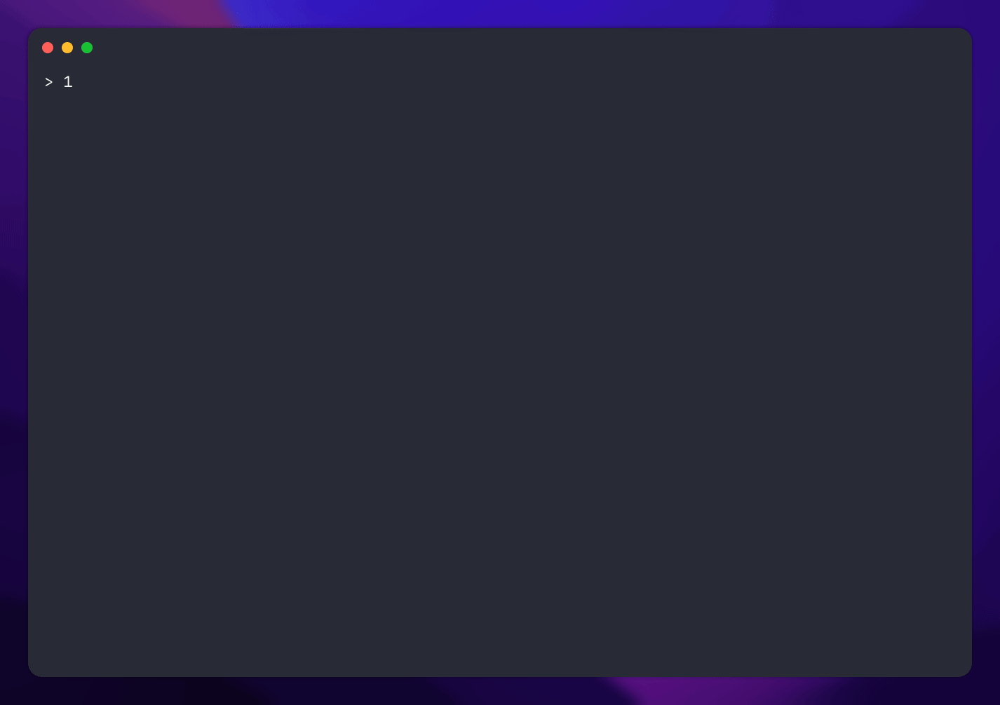

# **LebJS**
A JavaScript engine written in Java



## Common Usage

### Run a file
```sh
lebjs [file]
```

### Run the tests
```sh
lebjs -t [dir]
```
`[dir]` defaults to `./tests`

### Enter the REPL
```sh
lebjs
```

## REPL commands
```
.help                      Display this message
.clear                     Clear the screen
.inspect [expression]      Deep print the result of [expression]
```

## Flags
- `-t`, `--test` - Run tests
- `-v`, `--verbose` - Show stack traces for errors
- `--harness [value]` - Test harness. Valid options: `ladybird`
- `--parse-only` - Ignore test failures from parsing
- `--ignore-not-impl` - Ignore test failures from unimplemented features
- `--hide-passing` - Only output skipped / failing tests (ignored if `--no-buffer` specified)
- `--no-buffer` - Do not buffer test outputs
- `--disable-prompt` - Disable the `> ` prompt in the REPL
- `--gif` - Enable GIF rendering mode (No error handling, no prompt, print delimiter after execution)

## Spec compliance
Obviously, do not use this in production. The engine chooses to deviate from the specification in a number of places. *Some* of these instances are marked with the `@NonCompliant` annotation :^)